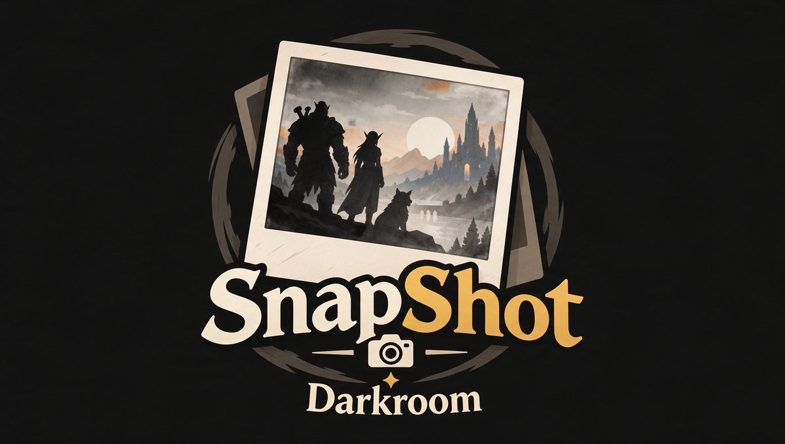

# SnapShot Darkroom

A one-page web app that turns SnapShot screenshots into polaroid prints.

Drop in screenshots → the page finds SnapShot's crop marks → cuts out the photo →
builds a fresh polaroid card around it → players add a caption, text, marker doodles,
stickers or tape → download as PNG or JPEG.

Everything runs in the player's browser. Nothing is uploaded anywhere.

**Live page:** https://dirtnasty5.github.io/snapshot-darkroom/

**SnapShot addon:** https://www.curseforge.com/wow/addons/snapshot-forever

## Files

| File | What it is |
| --- | --- |
| `index.html` | The whole darkroom: page, styles and code in one file. |
| `README.md` | This file. |
| `logo.jpg` | The SnapShot Darkroom logo (page header, drop area). |
| `banner.jpg` | Wide artwork shown when the link is shared on Discord, etc. |
| `icon.png` | Browser tab icon. |

## Crop mark spec (what the addon draws)

The darkroom only finds marks that match this. `CropMarks.lua` in the addon draws them.

- **Four corner brackets** drawn just **outside** a rectangle. Each bracket's inner corner
  touches the rectangle's corner exactly; its two arms run along the rectangle's edges.
- **Which rectangle:**
  - **Polaroid frame on:** the whole cream **card** (SnapShot 2.10.2+), so the card stays clean.
  - **Frame off:** the **photo** itself.
- **Colour:** pure magenta `#FF00FF`, fully opaque, with no filter, grain or vignette over it.
- **Outline:** near-black `#141414`, `O` px wide, around each arm except the side facing
  the rectangle, so nothing is drawn over the card or photo (SnapShot 2.10.3+; older
  versions drew it on all sides, and the darkroom trims `O + 1` px to clear that).
- **Size**, in physical screen pixels (`H` = screen height):
  - arm length `L = max(24, 3% of H)`
  - arm thickness `T = max(6, 0.6% of H)`
  - outline `O = max(3, T / 2)`
- The brackets must be fully on screen, so frameless layouts need at least `T + O`
  pixels between the photo and the screen edge.
- Show them only for the instant of the screenshot.

### Finding the photo inside a card

When the marked rectangle has a plain, light border along its top, left and right
edges, the darkroom treats it as a card:

- The photo's left, right and top edges are where that plain border ends (median of
  15 scan lines per side; the three borders must match).
- The photo's height comes from its shape (1:1, 16:9 or 9:16), picking the shape whose
  chin best matches SnapShot's card proportions: side border 6% and chin 26% of the
  photo's shorter side (chin ≈ 4.33 × border). The chin holds the caption, so it isn't scanned.
- If any of that doesn't hold, the rectangle is treated as the photo (frameless shots,
  and screenshots from SnapShot 2.10.0–2.10.1 where the marks hugged the photo).

### Keep original / Edit text

For polaroid shots the darkroom remembers both rectangles. **Card text → Keep original**
(the default) prints the in-game card exactly as it was, with SnapShot's own caption.
**Edit text** builds a fresh card around the photo with a caption you type. Doodles,
stickers, text boxes and the date stamp work in both, and stay lined up with the photo.
Frameless shots have no card, so they always get a fresh one.

Screenshots without marks still work: the player clicks **Adjust crop** and drags the box.

## Tested

- Real WoW screenshots (5120×2880, JPEG), all three shapes, with marks around the photo
  (2.10.1 style) and around the card (2.10.2 style, re-saved at JPEG 92%, 60% and 40%):
  every crop lands cleanly inside the photo (10 px trim at 5K, clearing the old outline).
- 258 synthetic screenshots: 1280×720 to 5120×2880 and 3440×1440 ultrawide, all three
  shapes, framed and frameless, JPEG 92% to 40%, busy backgrounds and pink decoys:
  every crop within 3 px. Detection takes about 0.1–0.2 s per screenshot.
